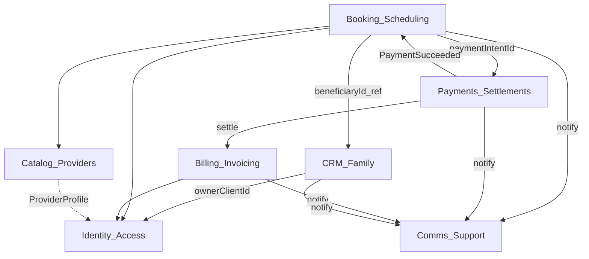

# Context map — DiaspoMoney (intégral)

## Contextes & dossiers

| Context | Domaine | Application actuelle |
| --- | --- | --- |
| Identity & Access | `domain/identity` | `models/User`, `services/auth`, `services/user`, `app/api/auth` |
| Catalog & Providers | `domain/catalog` | `models/Service*`, `Speciality`, `Partner`, `services/service`, `speciality` |
| Booking & Scheduling | `domain/booking` | `services/booking`, `facades/service-booking.facade`, `app/api/bookings` |
| Payments & Settlements | `domain/payment` | `strategies/payment`, `services/payment`, `app/api/stripe` |
| Billing / Invoicing | `domain/billing` | `models/Invoice`, `services/invoice`, `facades/invoice.facade` |
| CRM Family | `domain/crm` | beneficiary/complaint/quote repos + facades BTP/Education |
| Comms & Support | `domain/comms` | email, notification, messaging, SupportTicket |

## Relations (ACL)

| Upstream → Downstream | Style | Notes |
| --- | --- | --- |
| Booking → Payments | Customer/Supplier | Booking demande `PaymentProof` |
| Payments → Booking | Partner | Webhook / ConfirmBookingPayment |
| Booking → CRM | OHS / Conformist | Snapshot + `beneficiaryId` cible |
| CRM → Identity | Customer/Supplier | `ownerClientId` = UserAccount |
| * → Comms | Published Language | Events / `NotificationIntent` ; pas d’import Resend dans le métier |

## Fuites documentées (à éliminer)

1. `booking.service.deleteBookingCompletely` → Stripe refund
2. Facades CRM/BTP/Education → `notificationService` inline
3. Beneficiary créé via `user.service` (Identity)
4. Complaint.`appointmentId` au lieu de `bookingId`
5. Invoice status divergents schema vs types
6. Catalog `group` vs `category` vs `SPECIALITY_TYPES`

## Roadmap d’extraction

| Priorité | Context | Wire call site |
| --- | --- | --- |
| Done | Payments + Booking | `verifyPaymentProof`, ConfirmBookingPayment |
| P1 | Identity | `auth.service.register` |
| P1 | Billing | `invoice.service.createInvoice` |
| P1 | Catalog | `service.service.createService` |
| P2 | CRM | `beneficiary.facade` ownership |
| P2 | Comms | ports + retirer emails des facades métier |
| P3 | Extraire refund Stripe hors Booking ; façade Quote unique |
